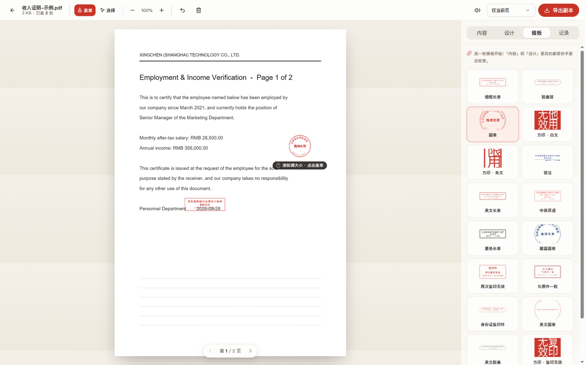

<div align="center">

# 小章 · 网页版

**给电子文件，盖个小小的章。**

在浏览器里给 PDF / 图片盖上「仅供××使用，他用无效」的用途章，
滚轮调大小、点击落章、导出 `_stamped` 副本 —— **全程本地处理，文件不上传，用完即走。**

[在线使用](https://jiqing112.github.io/2stamp/) · [报告问题](https://github.com/jiqing112/2stamp/issues) · [原版 macOS 应用](https://github.com/lemomo-ai/lemo-stampy)


</div>

---

## ✨ 功能

- **盖章台**：章跟着鼠标走，滚轮调大小（60%–250%），点哪儿盖哪儿；整个工作台都是「持章区」——指针在纸外时章贴边跟随，章永远完整留在页面里
- **17 枚内置模板**：长章 / 胶囊 / 圆章 / 方印 / 签注 × 常用 / 复印件 / 英文 / 方印，首页模板墙点任意一枚即可带着示例文件直接开始
- **内容随便改**：措辞（中文 / English / 中英）、机构、用途、主文字、第二行、自定义多行文字、日期与编号开关
- **外观随便改**：形制、边框（双线 / 单线 / 粗细线 / 无框）、七种字体（宋 / 楷 / 仿宋 / 隶 / 魏碑 / 黑体 / Serif）、四种印色（朱砂 / 胭脂 / 藏蓝 / 墨）、墨色浓度、字号、字距、旋转、印泥质感（干净 / 印泥 / 做旧）
- **编号可追溯**：每枚章自动带 `yyyy-MM-dd · No.XXXXXX`，「记录」页可查本次会话的每一枚去向
- **多页 PDF**：按「仅当前页 / 每一页同位置 / 仅第一页 / 仅最后一页」落章导出
- **选择模式**：点选已盖的章，拖动 / 旋转 / 缩放，Delete 删除，Ctrl+Z 撤销
- **可靠导出**：PDF 无损覆盖（原页面内容一字节不动，300dpi 透明印章）、带密码的 PDF 自动栅格化导出、页面带 /Rotate 旋转时坐标自动映射、图片导出 PNG
- **全程本地**：没有后端、没有上传、没有注册；断网也能用，关掉页面什么都不剩



## 📖 使用方法

1. **打开网页**，把 PDF 或图片**拖进页面**（或点「上传文件，开始盖章」）
2. 右侧**印台**选一枚模板，在「内容」里填给谁、办什么 —— 章上文字实时变化
3. **滚轮**调大小，**点一下**落章；切「选择」模式可拖动 / 旋转 / 删除已盖的章
4. 点**「导出副本」**，得到 `xxx_stamped.pdf` / `xxx_stamped.png` —— 原件一个像素都不会变

**快捷键**：

| 按键 | 作用 |
| --- | --- |
| 滚轮 | 调整章大小（手持章或选中的章） |
| `Esc` | 取消选中 → 回到盖章模式 |
| `Delete` / `Backspace` | 删除选中的章 |
| `Ctrl/Cmd + Z` | 撤销上一枚章 |
| `PageUp` / `PageDown` | 上一页 / 下一页（多页 PDF） |
| `Shift` + 旋转手柄 | 按 15° 吸附旋转 |

**没有文件？** 首页示例纸可以直接盖；或用内置示例：

| 链接 | 内容 |
| --- | --- |
| `/?sample=pdf` | 收入证明 PDF（2 页） |
| `/?sample=img` | 证件扫描图片 |
| `/?sample=exif180` / `?sample=rot180` | 诊断样本：EXIF 旋转扫描件 / 页面旋转 180° |

## 🛠 本地开发

要求 Node.js ≥ 18。

```bash
git clone https://github.com/jiqing112/2stamp.git
cd 2stamp
npm install
npm run dev        # 开发服务器，默认 http://localhost:5173
```

```bash
npm run build      # 产线构建到 dist/
npm run preview    # 本地预览产线包
npm run lint       # oxlint 静态检查
node scripts/make-samples.mjs       # 重新生成 public/ 下的示例文件
node scripts/make-diag-samples.mjs  # 重新生成 EXIF / 旋转诊断样本
```

## 🚀 部署

纯静态站点，构建产物就是 `dist/` 目录，扔到任何静态托管都行。

### GitHub Pages（推荐，已内置自动部署）

仓库已带 [.github/workflows/deploy.yml](.github/workflows/deploy.yml)：**推送到 `main` 分支即自动构建发布**。首次只需在仓库设置里开启一次：

> **Settings → Pages → Build and deployment → Source 选「GitHub Actions」**

之后每次 push，站点自动更新到 `https://<用户名>.github.io/2stamp/`。工作流会自动按仓库名设置子路径（`VITE_BASE=/<仓库名>/`），无需手动配置。

### Vercel

1. [vercel.com](https://vercel.com) → **Add New Project** → 导入本仓库
2. Framework Preset 选 **Vite**，其余默认 → **Deploy**

或命令行：`npm i -g vercel && vercel --prod`

### Netlify

1. [app.netlify.com](https://app.netlify.com) → **Add new site → Import an existing project**
2. Build command 填 `npm run build`，Publish directory 填 `dist` → **Deploy**

或命令行：`npm i -g netlify-cli && netlify deploy --prod --dir=dist`

### 其它静态托管 / 自己的服务器

```bash
npm run build
# 把 dist/ 目录上传到任意静态服务器（nginx / OSS / CDN …）
```

nginx 示例：

```nginx
server {
    listen 80;
    root /var/www/2stamp;
    location / { try_files $uri $uri/ /index.html; }
}
```

> 子路径部署（如部署在 `example.com/2stamp/` 下）：构建时设置环境变量 `VITE_BASE=/2stamp/` 再 `npm run build`。
> Windows PowerShell：`$env:VITE_BASE="/2stamp/"; npm run build`；Git Bash：`MSYS_NO_PATHCONV=1 VITE_BASE=/2stamp/ npm run build`。

## 🧱 技术实现

- **技术栈**：Vite + React 19 + TypeScript + Tailwind CSS（shadcn/ui 风格组件，Radix 原语）
- **印章引擎**（`src/lib/stamp/engine.ts`）：把原版 `StampCore/StampDesign.swift` 的排版算法逐条移植到 Canvas 2D ——
  五种形制的排版（圆章的上弧正文 / 下弧日期编号、方印朱文的字撑满格与白文的「刻字」路径相减）、
  边框规格、逐字弧形排字、SplitMix64 可复现随机的印泥质感（淡斑 + 缺墨颗粒 + 做旧缺口），与原版同一套参数
- **PDF**：pdf.js 预览（v6，规避 Chromium 图像解码器误用 JPEG EXIF 方向导致的整页颠倒）+ pdf-lib 导出（300dpi 透明印章覆盖到原页，带 /Rotate 旋转页坐标映射）；加密 PDF 走 pdf.js 解密 + 栅格化导出
- **性能**：印章位图按需渲染并缓存（≥144dpi，只缩不放）、覆盖层拆「已盖层 / 幽灵层」双 canvas、幽灵位置走 ref + rAF（指针移动零 React 重渲染）、无常驻毛玻璃
- **字体**：优先本机字体（宋 / 楷 / 仿宋 / 隶 / 黑体），缺失时自动回退 Google Fonts（Noto Serif SC / ZCOOL XiaoWei / Ma Shan Zheng / Playfair Display）

```
src/
├── lib/
│   ├── stamp/          # 类型、绘制引擎、17 模板、措辞与编号生成
│   ├── pdf.ts          # pdf.js 预览 / pdf-lib 导出
│   ├── export-image.ts # 图片导出
│   ├── sound.ts        # WebAudio 现场合成的落章音
│   └── ui/             # shadcn 风格组件
├── components/         # StampSurface（盖章台面）、Mascot（五表情小章）、SamplePaper…
└── views/              # Landing（首页）与 Editor（工作台）
```

## ❓ 常见问题

**文件会被上传吗？**
不会。读取、盖章、导出全部发生在你的浏览器里，没有后端，断网也能用。

**原始文件会被修改吗？**
不会。章只盖在导出的 `_stamped` 副本上，PDF 原样保留、仅在其上叠加印章图层。

**加密的 PDF 可以吗？**
可以。输入一次密码即可预览盖章，导出的副本自动栅格化（内容不变，只是变成高清位图页）。

**扫描件方向不对 / 整页颠倒？**
已修复。本项目的 pdf.js 配置会剥离扫描件 JPEG 里误导性的 EXIF 方向标记，带 `/Rotate` 旋转的页面也已正确处理；如再遇到请提 [issue](https://github.com/jiqing112/2stamp/issues) 并附上 `?sample=exif180` 的表现。

**浏览器有要求吗？**
Chrome / Edge 99+、Safari 16.4+、Firefox 126+（需要 `letterSpacing` 之外的常规 Canvas 能力即可，上述为实际测试基线）。

**记录会保存吗？**
不会。「记录」只在当前页面的内存里，关掉就没了 —— 用完即走。

## 🙏 致谢与许可

交互范式、印章设计与绘制算法来自 **[小章 Stampy](https://github.com/lemomo-ai/lemo-stampy)**（macOS 菜单栏应用，MIT License），吉祥物与文案精神也一并致意。本项目是其网页复刻版，同样以 [MIT](LICENSE) 开源。

> 小章不代表任何机构，也不提供机构公章样式 —— 它只是你自己的用途声明。
